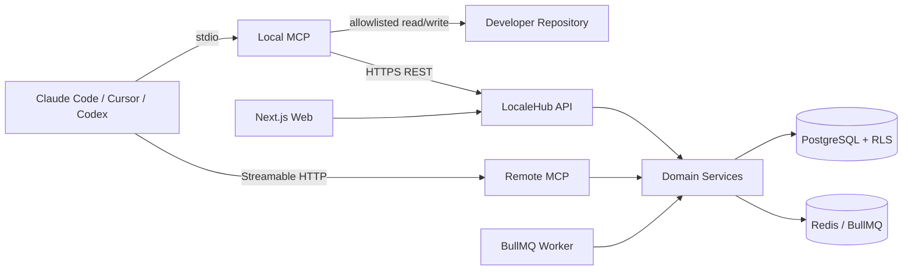

# 架构与模块边界

## 1. 总览



**单一业务实现**：REST API、Remote MCP、Local MCP（经由 API）、Worker 与 Web 都调用
`packages/domain` 的同一套服务；不存在三套翻译业务逻辑。

## 2. 服务划分

| Service | 技术 | 职责 | 网络 |
|---|---|---|---|
| nginx | nginx | HTTPS / 网关 | edge + app |
| web | Next.js 15 + shadcn/ui | 管理后台（Tailwind v4 设计令牌） | app |
| api | NestJS 10 | REST API `/api/v1` | app + egress |
| worker | BullMQ | QA 运行、导入导出、通知、AI 任务 | app + egress |
| mcp-remote | Node + MCP SDK | 平台侧 MCP（Streamable HTTP） | app |
| postgres | PostgreSQL 16 | 主数据库（RLS） | app only |
| redis | Redis 7 | 队列 | app only |

Local MCP **不在**服务端 Compose 中：它是安装在开发者机器 / CI Runner 上的包，因为需要访问
本地仓库。私有化如需容器化，只能挂载指定仓库目录（只读或受控读写），禁止挂载 `/`、
Docker socket 或整个 Home。

## 3. 包依赖方向（无环）

```text
contracts  ← 所有包
format-adapters → contracts
sync-engine     → contracts
workspace       → contracts, format-adapters
permissions     → contracts
database        → contracts
config          → contracts
domain          → contracts, database, permissions, sync-engine
api-client      → contracts
apps/*          → 上述包
```

`apps/cli` 额外依赖 `database` + `domain`（seed 命令），是唯一允许"跨层"的应用。

## 4. 关键模块

### 4.1 packages/sync-engine（纯函数）

`computeSyncDiff`（三方比较）、`buildSyncPlan`（确定性计划与哈希）、`summarize`、
`resolveConflictValue`、`buildApplyPlan` / `verifyApplyPlan`（回写计划与旧值校验）。
无 IO、无数据库、无网络 → 可完全单测，且本地与平台用**同一份**算法，保证计划哈希一致。

### 4.2 packages/workspace（本地边界）

`WorkspaceGuard`：路径规范化、`..` 拒绝、realpath 符号链接逃逸检测、`allowRead/Write`、
`denyRead/Write`、文件映射联合校验。`SafeFileWriter`：备份 + 临时文件 + fsync + 原子 rename +
写后重解析回滚。`GitClient`：只读 diff / branch / commit，从不 commit / push。

### 4.3 packages/format-adapters

统一 `FormatAdapter` 接口；JSON 通过自研 span scanner 做**原地 token 替换**，因此缩进、键序、
注释与未知字段逐字节保留；其余格式（YAML 用 Document API，.strings/.stringsdict/Android XML/
PO/XLIFF 用带偏移的正则扫描）同样是原地补丁而非整体重写。

### 4.4 packages/database

Prisma Schema + 手写 RLS 迁移（32 张租户表）。`TenantPrisma.withOrganization()` 在事务内
`SET LOCAL app.current_org_id`，`withoutTenantScope()` 用于登录/Token 校验等"还不知道租户"的
特权路径（记 `app.bypass_rls=on`）。应用连接使用非 owner 角色 `localehub_app`，因此 RLS 真正生效。

### 4.5 packages/domain

`SyncService`（scan/preview/push/changes/baselines/conflicts/apply-reports/status/validate）、
`translation-core`（Key/Version/Entry 的不可变版本写入与 STALE 标记）、`events`（revision + 事件）、
`qa`（规则引擎）、`ai`（Provider 适配器）、`crypto`（bcrypt、Token 哈希、AES-256-GCM）。

### 4.6 apps/api

NestJS 模块化：全局 `AuthGuard`（会话 JWT 或 `lh_mcp_*` Token → `ActorContext`）、
`@RequireRole` / `@RequireScopes` 装饰器、统一响应信封与错误码、`RequestContextMiddleware`
（request_id + AsyncLocalStorage）、`AuditService`。控制器只做参数校验与编排，业务在 domain。

### 4.7 apps/mcp-local

14 个工具 + 2 个 Resource + 4 个 Prompt。工具实现调用 `WorkspaceGuard` / `SafeFileWriter` /
`GitClient` / `ApiClient`，并通过 `.localehub/state.json` 串联 preview → push、pull → apply →
report 的多步流程。`confirm=false` 一律拒绝写操作。

### 4.8 apps/mcp-remote

无状态 Streamable HTTP：每个请求自带 Bearer Token，服务端即时解析 Actor 并构造工具集，
不存在跨请求的会话状态。

### 4.9 apps/web（shadcn/ui）

前端使用 **shadcn/ui**（`new-york` 风格、`zinc` 基色、Radix 原语、Tailwind CSS v4）：

- 组件以源码形式位于 `apps/web/src/components/ui/`，与上游注册表保持一致，便于 `npx shadcn@latest add --diff` 增量更新。
- 设计令牌集中在 `src/app/globals.css` 的 `:root` / `.dark` + `@theme inline`，业务代码只用语义色
  （`bg-background`、`text-muted-foreground`），不写裸色值。
- 状态色（success / warning / info）是本项目新增的语义令牌，供 `Badge`、`Alert` 变体与冲突三栏对比使用，
  明暗两套取值都在同一个文件里。
- 主题由 `ThemeProvider` 管理（light / dark / system），首屏用内联脚本写入 `.dark` 类避免闪烁。
- 组件使用约定：表单用 `FieldGroup` + `Field`，空态用 `Empty`，加载用 `Skeleton`/`Spinner`，
  提示用 `sonner`，按钮内图标用 `data-icon`，分组项（`SelectItem`、`DropdownMenuItem`）必须包在对应 `*Group` 内。

## 5. 横切关注点

| 关注点 | 实现 |
|---|---|
| 认证 | 会话 JWT（HS256，12h）或 API/MCP Token（SHA-256 存储） |
| 授权 | `packages/permissions` 的 `assertRole` / `assertScope` / `assertProjectBound` / `assertLocaleAllowed` |
| 租户隔离 | 数据库 RLS + 每次查询携带 organization_id |
| 幂等 | `SyncPlan.confirmedAt` 幂等重放 + `contentHash` 去重 + `Idempotency-Key` |
| 并发 | `projects.revision` 乐观锁（`REVISION_MISMATCH` 要求重新预览） |
| 审计 | `audit_logs`（含 request_id、session、client、耗时；自动脱敏） |
| 错误 | 稳定错误码（`SYNC_PLAN_EXPIRED`、`REVISION_MISMATCH`、`APPLY_REJECTED_STALE_PREVIEW` …） |
| 观测 | `/health`、`/health/ready`、`/system/queues`、结构化日志 |

## 6. 为什么这样设计

- **计划哈希 + 服务端重算**：客户端不能"自报变更"，防止绕过预览直接写平台。
- **App 层三态比较放在纯函数包**：Local MCP 与平台必须得出完全一致的结论，否则计划哈希必然对不上。
- **原地补丁而非整体重写**：翻译文件的 diff 必须只包含预期条目，否则代码评审无法信任。
- **RLS 而非仅应用层过滤**：任何遗漏 `where organizationId` 的查询都不会泄漏数据。
