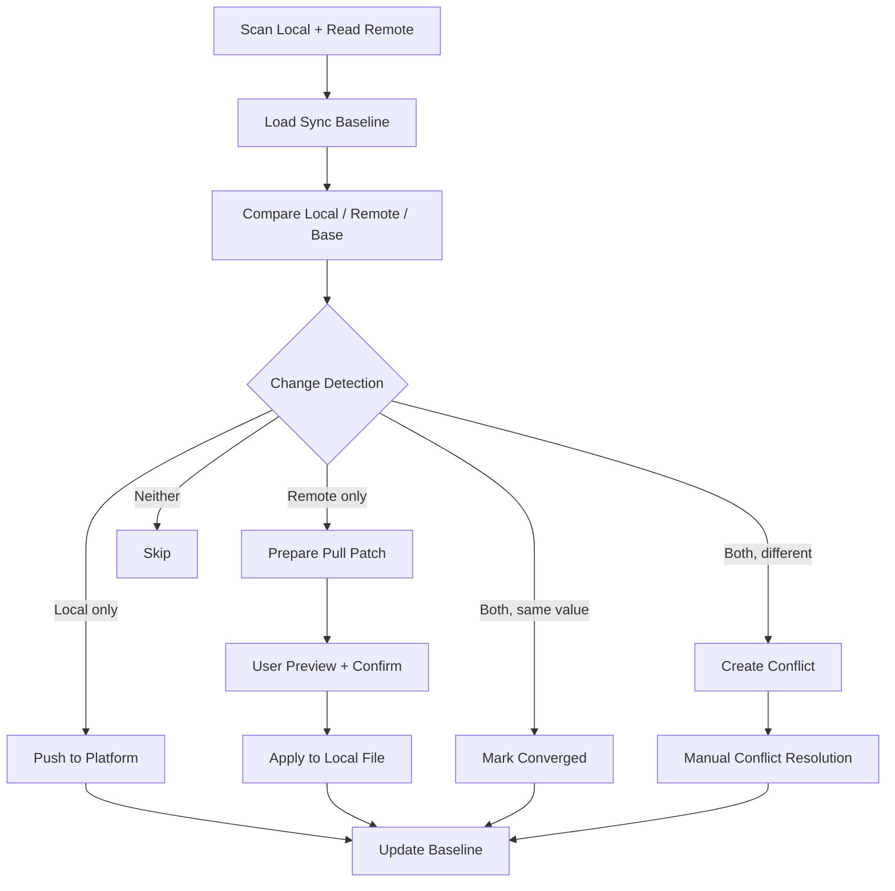

# LocaleHub 产品需求文档（PRD）

## 1. 产品定位

LocaleHub 是面向开发人员、产品经理、翻译人员与审核人员的多语言管理平台，支持 SaaS 与私有化
Docker 部署。**核心差异化能力是代码仓库与平台之间的双向本地化同步闭环**：不是单纯"翻译管理"，
而是让语言资源在仓库与平台之间安全流动，且永不静默覆盖。

## 2. 用户与角色

| 角色                       | 权限摘要                                            |
| -------------------------- | --------------------------------------------------- |
| Platform Admin             | 平台运营、SaaS 配置、租户管理（跨租户，走特权路径） |
| Organization Owner / Admin | 组织成员、项目、AI Provider、MCP 客户端、安全策略   |
| Project Manager            | 项目、语言、术语、审核流程、发布管理                |
| Developer                  | 连接仓库、导入原文、同步文件、查看问题              |
| Product Manager            | 修改原文/译文、管理上下文、发起审核                 |
| Translator                 | 编辑被分配语言的译文                                |
| Reviewer                   | 审核译文、通过或退回                                |
| Readonly                   | 只读查看授权项目                                    |

角色在**服务端**校验；REST API、Remote MCP、CLI 与 Web UI 共用同一套判定逻辑。

## 3. 核心业务流程

### 3.1 首次连接仓库

创建项目 → 生成 MCP Token → 在仓库执行 `localehub init` → `localehub scan` → `localehub sync
preview` 展示变更 → 用户确认 → `localehub sync push --confirm` → 平台创建 Key / Source Version /
Translation Version / Sync Baseline → 返回同步摘要与远端 revision。

### 3.2 本地更新推送到平台

Git 变化 → `scan_local_project` → Parser/Adapter 规范化 → 内容哈希与基线比较 → `preview_sync`
→ 用户确认 → `push_project_changes` → API 校验权限、版本、幂等键 → Sync Engine upsert →
原文变化时将依赖旧 Source Version 的译文标记 `STALE` → 保存 Sync Session / Items / Baseline。

支持：新增 Key、修改原文、修改本地译文、删除 Key（默认归档而非物理删除）、新增 Locale 文件、
文件映射变更。删除必须预览。

### 3.3 平台修正译文写回仓库

产品经理或翻译在编辑器修改译文 → 保存草稿 → 审核通过（`APPROVED`，产生 `translation.changed`
事件）→ 开发者执行 `pull_platform_updates` → `preview_apply` 生成 patch（文件、Key、旧值、新值、
来源版本、审核状态）→ 默认只有 `APPROVED` 可应用 → 用户确认 → `apply_translation_updates`
（备份 + 原子写入 + 重解析）→ 输出 Git diff → 回报 apply report。

**平台修改 ≠ 本地已修改**：必须经过 pull → preview → apply 三步，平台记录 `applied_to_repo`
状态与本地 commit。

### 3.4 状态机

## 4. 功能需求

### 4.1 翻译管理

Key / Namespace / Platform / Locale 维度管理；源文与译文并排编辑；不可变版本历史；
草稿 → 待审核 → 已审核 → 退回 工作流；过期（STALE）标记；按语言/状态/平台/关键字检索。

### 4.2 质量中心

内置规则：空译文、占位符不一致、缺译、过期译文、标记不匹配、标点不一致、首尾空白、双空格、
术语未使用、与源文相同。规则可在项目级启停；可在 API 内同步运行，也可投递 BullMQ 异步运行。

### 4.3 AI 工作区

Provider 适配器：Anthropic / OpenAI 兼容 / Ollama / 内置离线启发式（默认，无需网络）。
AI 产出**一律草稿**；AI 审核结果只是建议，不能改变状态、不能绕过人工审核与发布权限。

### 4.4 术语与翻译记忆

术语库（含目标语言对应词、大小写敏感开关）；翻译记忆（按源文哈希检索，命中计数）。

### 4.5 仓库同步

仓库连接、文件映射、CLI 心跳与版本、同步历史、同步计划预览、变更详情、冲突处理。

### 4.6 发布

发布快照锁定 Key、源文版本、译文版本与内容哈希；发布前校验（`validate_release`）。

## 5. 非功能需求

- **正确性优先**：任何"方便但会丢数据"的默认行为都不采用。
- **可追溯**：每次操作记录 request_id / org / project / connection / sync_session / mcp_client /
  actor / 工具名 / 结果 / 耗时；审计日志不记录 Token、密钥与源码正文。
- **可重试**：同步会话与条目独立状态；幂等键防重复建版本；断网后可续跑。
- **隔离**：组织级 RLS；数据库连接使用非 owner 角色。
- **最小权限**：MCP Token 默认不具备超级管理员权限；push 与 apply 分离授权。
- **可观测**：健康检查、队列深度、结构化日志、同步会话指标。

## 6. 验收场景

| 场景                   | 期望                                                                            |
| ---------------------- | ------------------------------------------------------------------------------- |
| A 本地新增 Key 推送    | 平台可查到 Key、源文、文件路径、commit；同一 commit 重复执行不产生重复版本      |
| B 平台修复日语译文回写 | 只修改映射的日语文件；文件可重新解析；Git diff 只含预期条目；平台记录已应用版本 |
| C 两端都修改同一 Key   | preview 产生 conflict，不自动选边；解决后产生新版本与新基线                     |
| D 平台存在草稿         | 默认不进入 pull/apply；显式策略与权限允许时才可见，且带风险提示                 |
| E 原文变更             | 生成新 Source Version；依赖旧版本的目标语言标记 STALE；历史保留                 |

以上 A–E 全部由 `apps/e2e-demo/src/run-demo.ts` 与集成测试自动验证。

## 7. 明确不做（本版本）

- 不把平台当作能访问用户电脑文件系统的服务。
- 不按文件时间戳判断同步。
- 不覆盖历史翻译版本。
- 不把未审核译文默认回写正式语言文件。
- 不给 MCP Token 默认超管权限。
- 不在 API/Worker 进程内执行上传脚本。
- 不默认上传整仓源码（仅同步配置的本地化文件；代码上下文按白名单按需读取）。
